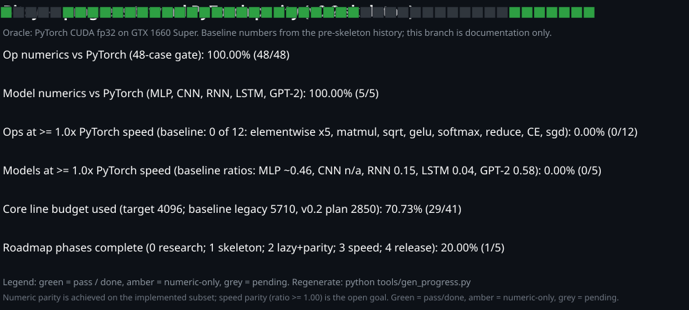

# Bitsy

A small fp32 deep-learning framework with a C11 core and a Vulkan compute
backend. The goal is **PyTorch parity**: correct numerics and comparable speed
on this GPU (GTX 1660 Super), following tinygrad's "fewest lines, maximum
performance" philosophy.

> **This branch (`docs/framework-study-and-roadmap`) is documentation only —
> no framework code.** It records the framework research, the project skeleton,
> the feature parity matrix, the line budget, and a progress tracker that will
> be driven by measurements once implementation begins.



*The image above tracks two axes: numeric parity (max-abs-diff within tolerance
vs real PyTorch CUDA, fp32) and speed parity (`torch_ms / bitsy_ms`, where 1.00
means as fast as PyTorch). It is generated from `docs/progress.json` with
`python tools/gen_progress.py`. The numbers shown are the inherited baseline
from the previous architecture; this branch is the plan to improve them.*

## What is here

| File | Purpose |
|---|---|
| [ROADMAP.md](ROADMAP.md) | Phased plan for the v0.2 skeleton (C+Vulkan, Python, benchmarks) |
| [SKELETON.md](SKELETON.md) | Directory/module layout for the implementation |
| [FEATURE_PARITY_MATRIX.md](FEATURE_PARITY_MATRIX.md) | Per-op / per-model numeric + speed status vs PyTorch |
| [LINE_BUDGET.md](LINE_BUDGET.md) | ≤ 4096-line C core rule and allocation (stretch 2048) |
| [BENCHMARK_METHODOLOGY.md](BENCHMARK_METHODOLOGY.md) | How numerics and speed are measured against PyTorch |
| [docs/research/FRAMEWORKS.md](docs/research/FRAMEWORKS.md) | High-level study of tinygrad, PyTorch, JAX |
| [docs/progress.json](docs/progress.json) | Data behind the progress image |
| [tools/gen_progress.py](tools/gen_progress.py) | Regenerates `assets/progress.svg` |
| [tools/count_lines.py](tools/count_lines.py) | Enforces the C core line budget |

## Design in one paragraph

PyTorch is the **numeric oracle**; tinygrad is the **architecture** (lazy graph
→ fusion scheduler → a handful of parameterized kernels → captured command
buffer replay); JAX contributes **IR hygiene** (a small explicit typed IR and
pure functional ops so autodiff and JIT compose). fp32 is the main dtype. We
judge quality only by two measured numbers per op and per model step:
`max_abs_diff` vs PyTorch and `pytorch_ms / bitsy_ms`. The framework is "done"
when the core is under 4096 lines, every implemented op matches PyTorch within
tolerance, and the speed ratios reach 1.00 — or a documented ceiling explains
why they cannot.

## Reproducing the progress image

```sh
python tools/gen_progress.py     # writes assets/progress.svg from docs/progress.json
python tools/count_lines.py      # enforces the 4096-line C core budget (implementation branch)
```

See [ROADMAP.md](ROADMAP.md) for the phases and exit criteria.
